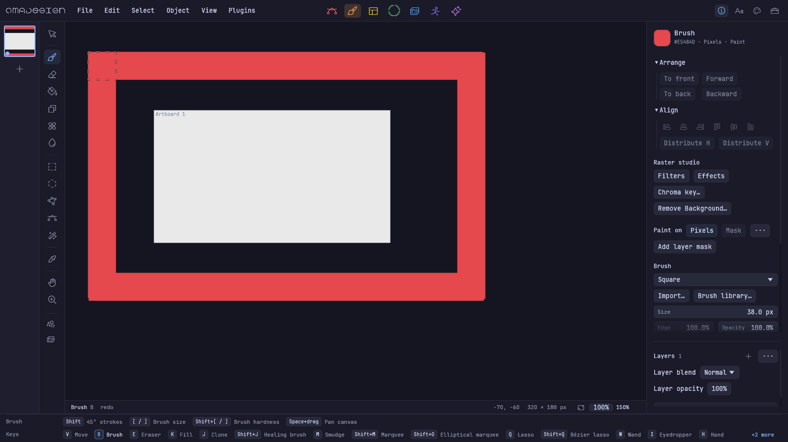

# Brush canvas bounds — issue #208

Brush strokes previously clipped to a pixel layer's original bitmap. Artboard
resizing did not resize that bitmap. The reported 7840 × 1080 layer therefore
painted only inside a thin rectangle on a much larger canvas.

Pixel layers now grow as brush strokes cross their edges, including negative
coordinates. Existing pixels retain their world positions, including on rotated,
scaled and sheared layers. Masks move with their native grid; selections retain
their world coordinates. A stroke's pixels, bounds and mask form one Undo step.
Cancellation and empty selected-out strokes restore the original layer.

An empty layer can start far from the original canvas without allocating the
empty gap. Growth includes rotated tip corners and scatter, pads edges to reduce
reallocations, and rejects invalid positions or growth beyond 64 million pixels
per layer with a visible status message. Add another pixel layer for a larger
span. This fixes bitmap clipping; intentional selections and masks still apply.

The new edge-crossing regression fails on the published source before this fix.
The focused retouch suite passed: 21 tests, zero failures, one ignored manual
benchmark. All-target compilation passed. The final library result is recorded
below after the complete run.

The native WGPU replay paints a Square brush around all four sides of a
320 × 180 bitmap. Its stroke runs from (-70, -60) to (-70, 240), (430, 240),
(430, -60), and back. All four outside samples contain paint. The grid grows to
640 × 448; the document and artboard remain 320 × 180. Undo restores the exact
original document; Redo and save/reopen restore the exact painted document.

[Native replay receipt](native-result.json) · [Native editor screenshot](native-canvas.png)



Reproduce on an isolated Wayland display, with its XDG_RUNTIME_DIR and
WAYLAND_DISPLAY set:

```sh
mkdir -p .t
TMPDIR="$PWD/.t" cargo run --bin brush_qa -- --canvas "$PWD/artifacts/brush-canvas-bounds/native"
```

The replay injects egui pointer events into the actual native editor on a private
headless Wayland display. It does not claim physical tablet testing. The owner's
running editor and published October 13 nightly are unchanged by this unreleased
fix.
